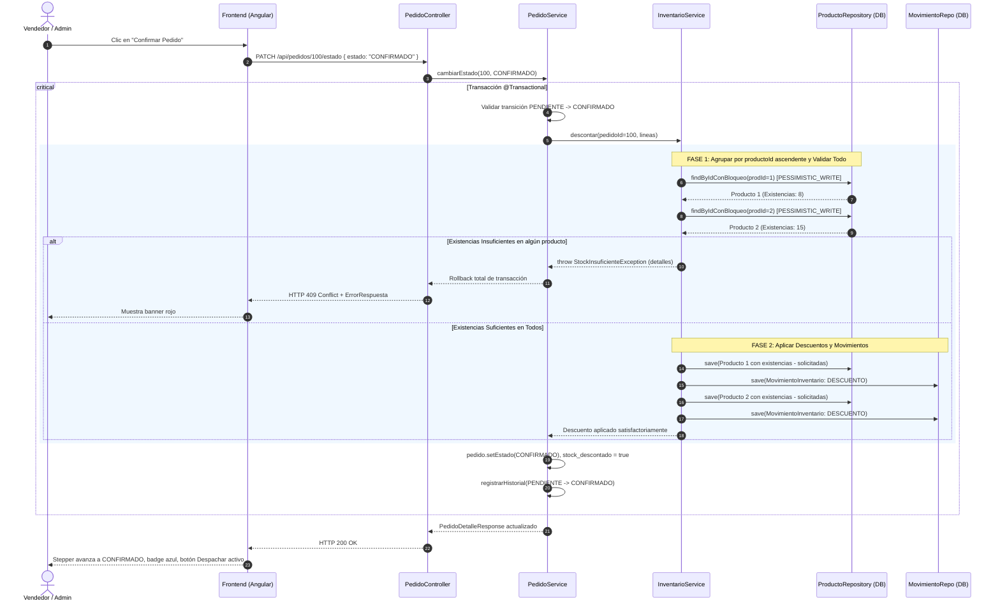
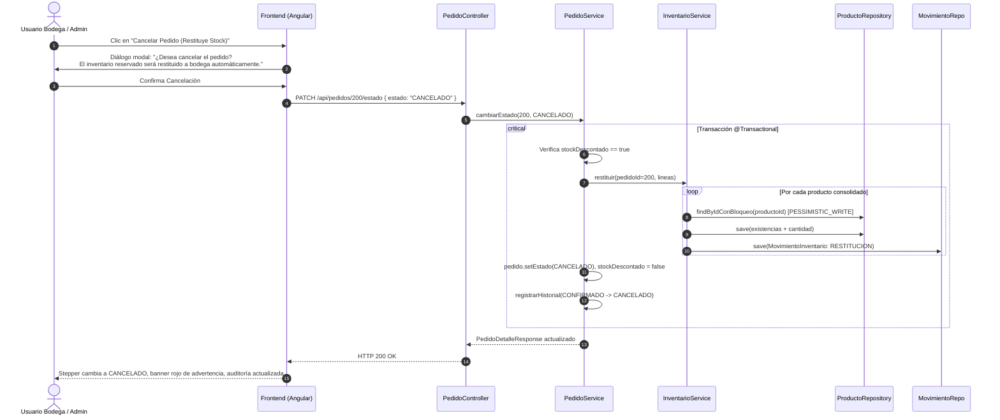
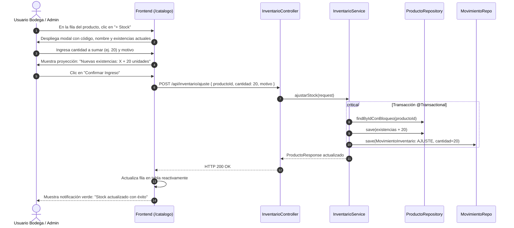

# 02 - Diagramas de Procesos del Sistema

**Proyecto:** La Dorada S.A.S. – Sistema de Pedidos e Inventario  
**Versión:** 1.0.0  
**Fecha:** 2026-11-10  

---

## 1. Flujo Global del Ciclo de Vida de Pedidos

El siguiente diagrama modela la interacción entre los actores (**Vendedor**, **Administrador**, **Bodega**) y el **Sistema Transaccional**:

```mermaid
flowchart TD
    Inicio([Inicio: Cliente solicita cotización/compra]) --> Venta[Vendedor registra líneas de pedido en Angular]
    
    Venta --> DecisionTipoGuardado{¿Modalidad de guardado?}
    
    DecisionTipoGuardado -->|Guardar como Pendiente| PedidoPendiente[Pedido creado en estado PENDIENTE<br/>stock_descontado = false]
    DecisionTipoGuardado -->|Confirmar Pedido Directo| ValidacionFase1
    
    PedidoPendiente --> AccionPendiente{Acción sobre Pendiente}
    
    AccionPendiente -->|Modificar Líneas| ModifLineas[PUT /api/pedidos/{id}<br/>Recálculo de subtotales y total]
    ModifLineas --> PedidoPendiente
    
    AccionPendiente -->|Rechazar Pedido| Rechazar[PATCH estado = RECHAZADO<br/>Sin movimientos de stock]
    Rechazar --> FinRechazado([Fin: Pedido Rechazado - Terminal])
    
    AccionPendiente -->|Cancelar Preventivo| CancelarPrev[PATCH estado = CANCELADO<br/>Sin movimientos de stock]
    CancelarPrev --> FinCancelado([Fin: Pedido Cancelado - Terminal])
    
    AccionPendiente -->|Confirmar Pedido| ValidacionFase1
    
    subgraph TransaccionConfirmacion ["Transacción ACID de Confirmación"]
        ValidacionFase1[Fase 1: Bloqueo Pesimista de Productos<br/>SELECT FOR UPDATE ordenados por ID] --> CheckStock{¿Todas las líneas<br/>tienen existencias suficientes?}
        
        CheckStock -->|No| RollbackConfirm[Rollback de transacción<br/>Lanza StockInsuficienteException 409]
        CheckStock -->|Sí| Fase2[Fase 2: Aplicar descuentos en producto<br/>Registrar movimientos DESCUENTO en Kardex]
        Fase2 --> SetConfirmado[Cambio a estado CONFIRMADO<br/>stock_descontado = true]
    end
    
    RollbackConfirm --> ErrorVisual[Frontend muestra alerta roja #FDE5E3<br/>con detalle: 'Producto X: pediste N y hay M disponibles']
    ErrorVisual --> PedidoPendiente
    
    SetConfirmado --> NotifBodega[Bodega visualiza pedido confirmado en cola]
    
    NotifBodega --> AccionConfirmado{Acción de Bodega / Admin}
    
    AccionConfirmado -->|Despachar Mercancía| Despacho[Bodega embala y despacha<br/>PATCH estado = DESPACHADO]
    Despacho --> FinDespachado([Fin: Pedido Despachado - Éxito Terminal])
    
    AccionConfirmado -->|Cancelar Pedido Confirmado| CancelacionRestitucion[Confirmación de usuario:<br/>¿Restituir inventario a bodega?]
    
    CancelacionRestitucion --> TransaccionRestitucion[Bloqueo pesimista de productos<br/>Reintegro de existencias a producto<br/>Registrar movimientos RESTITUCION<br/>PATCH estado = CANCELADO<br/>stock_descontado = false]
    
    TransaccionRestitucion --> FinCancelado
```

---

## 2. Diagrama de Secuencia: Confirmación con Validación en 2 Fases y Bloqueo Pesimista

Este diagrama detalla cómo se previene la concurrencia y sobreventa cuando se confirma un pedido:



---

## 3. Diagrama de Secuencia: Cancelación de Pedido Confirmado con Restitución



---

## 4. Diagrama de Proceso: Ingreso de Mercancía / Ajuste Físico (+ Stock)



---

## 5. Diagrama de Proceso: Autenticación y Autorización por Roles

```mermaid
flowchart TD
    Peticion[Usuario ingresa credenciales en /login] --> AuthAPI[POST /api/auth/login]
    
    AuthAPI --> ValidarDB{¿Credenciales válidas<br/>y usuario activo?}
    
    ValidarDB -->|No| Err401[Retorna HTTP 401 Unauthorized<br/>Credenciales inválidas o usuario inactivo]
    Err401 --> AlertaLogin[Frontend muestra alerta en rojo]
    
    ValidarDB -->|Sí| Ok200[Retorna HTTP 200 OK<br/>id, nombre, email, rol]
    Ok200 --> GuardarLocal[Frontend almacena en localStorage<br/>Emite en AuthService.usuarioActual$]
    
    GuardarLocal --> Routing{Navegación en Frontend}
    
    Routing -->|/inicio| Todos[Accesible para todos los roles]
    
    Routing -->|/nuevo-pedido| GuardRole1{AuthGuard + RoleGuard<br/>roles: ADMIN, VENDEDOR}
    GuardRole1 -->|Permitido| VistaNuevoPed[Carga formulario de pedido]
    GuardRole1 -->|Denegado (Bodega)| RedirInicio1[Redirige a /inicio]
    
    Routing -->|/catalogo| VistaCatalogo[Consulta de catálogo: Todos]
    VistaCatalogo --> BotonesCatalogo{Rol del Usuario}
    BotonesCatalogo -->|ADMINISTRADOR| BtnsAdmin[Visible: Crear, Editar, Activar/Desactivar, +Stock]
    BotonesCatalogo -->|BODEGA| BtnsBodega[Visible: +Stock para ingreso físico]
    BotonesCatalogo -->|VENDEDOR| BtnsVendedor[Modo Solo Lectura de catálogo]
    
    Routing -->|/pedidos/:id| VistaDetalle[Detalle de orden: Todos]
    VistaDetalle --> AccionesPedido{Estado del Pedido y Rol}
    AccionesPedido -->|PENDIENTE + (ADMIN o VENDEDOR)| BtnConfirmar[Habilitado: Confirmar, Modificar, Rechazar, Cancelar]
    AccionesPedido -->|CONFIRMADO + (ADMIN o BODEGA)| BtnDespacho[Habilitado: Despachar, Cancelar con Restitución]
    AccionesPedido -->|CONFIRMADO + VENDEDOR| BloqueoVentas[Sin acciones disponibles de transición]
```
