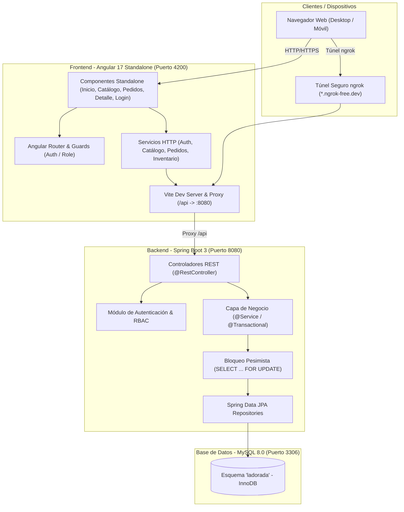
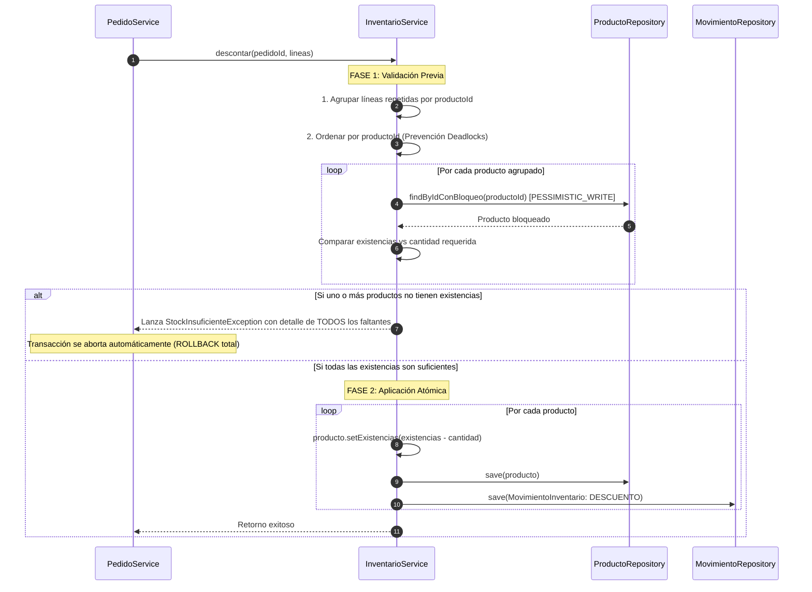

# 04 - Arquitectura del Sistema

**Empresa:** La Dorada S.A.S.  
**Sistema:** Gestión de Pedidos e Inventario  
**Versión:** 1.0.0  
**Fecha:** 2026-11-09  

---

## 1. Visión General de la Arquitectura

El sistema de **La Dorada S.A.S.** está concebido bajo una arquitectura desacoplada cliente-servidor de tres capas principales:

1. **Capa de Presentación (Frontend):** Aplicación de página única (SPA) desarrollada en **Angular 17** con componentes *standalone*, SCSS modular mobile-first y gestión de reactividad con RxJS.
2. **Capa de Negocio y Servicios (Backend API REST):** Servicio transaccional desarrollado en **Spring Boot 3** (Java 17) estructurado en capas limpias (*Controller*, *Service*, *Repository*, *Model*, *DTO*).
3. **Capa de Persistencia (Base de Datos Relacional):** Instancia de **MySQL 8.0** con motor de almacenamiento InnoDB, garantizando integridad referencial, restricciones de dominio (CHECK) y transacciones ACID.



---

## 2. Arquitectura del Backend (Spring Boot 3 + Java 17)

### 2.1 Estructura Modular de Paquetes

El código fuente del backend se organiza bajo el paquete raíz `com.ladorada.sistema`, segregado por módulos de dominio de negocio:

```
com.ladorada.sistema
├── auth                # Autenticación, usuarios y roles (RBAC)
│   ├── controller      # AuthController
│   ├── dto             # LoginRequest, UsuarioResponse
│   ├── model           # Usuario, RolUsuario
│   ├── repository      # UsuarioRepository
│   └── service         # AuthService
├── catalogo            # Catálogo maestro de productos y clientes
│   ├── controller      # ProductoController, ClienteController
│   ├── dto             # Requests y Responses de Producto y Cliente
│   ├── model           # Producto, Cliente
│   ├── repository      # ProductoRepository, ClienteRepository
│   └── service         # ProductoService, ClienteService
├── pedidos             # Ciclo de vida y transición de pedidos
│   ├── controller      # PedidoController
│   ├── dto             # CrearPedidoRequest, PedidoDetalleResponse, etc.
│   ├── model           # Pedido, PedidoLinea, PedidoHistorialEstado, EstadoPedido
│   ├── repository      # PedidoRepository, PedidoLineaRepository, HistorialRepository
│   └── service         # PedidoService
├── inventario          # Kardex, movimientos y ajustes de bodega
│   ├── controller      # InventarioController
│   ├── dto             # AjusteInventarioRequest, MovimientoResponse
│   ├── model           # MovimientoInventario, TipoMovimiento
│   ├── repository      # MovimientoInventarioRepository
│   └── service         # InventarioService
├── config              # Configuración global (CORS, Jackson, Timezones)
└── exception           # Manejo global de errores (GlobalExceptionHandler)
```

### 2.2 Patrones de Diseño Aplicados

- **Capa de Controladores (`@RestController`):** Exclusivamente responsable de validar el contrato HTTP, deserializar payloads JSON, mapear códigos de estado HTTP (200, 201, 400, 404, 409, 500) y delegar a la capa de servicio.
- **Capa de Negocio (`@Service`):** Contiene las reglas del negocio, orquestación transaccional (`@Transactional`), cálculos y validaciones de estado.
- **Capa de Acceso a Datos (`@Repository`):** Interfaces que extienden `JpaRepository<T, ID>`, aprovechando Spring Data JPA y consultas JPQL optimizadas.
- **DTOs Inmutables y Validación con Bean Validation:** Uso de `@Valid`, `@NotNull`, `@NotBlank`, `@Positive` y `@Size` en los payloads de entrada para evitar estado inconsistente en la aplicación.
- **Manejo Centralizado de Excepciones (`@ControllerAdvice`):** `GlobalExceptionHandler` intercepta excepciones de negocio (`StockInsuficienteException`, `TransicionInvalidaException`, `RecursoNoEncontradoException`) y genera respuestas estandarizadas RFC-7807/ProblemDetails:
  ```json
  {
    "codigo": "STOCK_INSUFICIENTE",
    "mensaje": "Stock insuficiente para confirmar el pedido",
    "detalles": ["Cloro 2 L: pediste 10 y hay 8 disponibles"],
    "timestamp": "2026-11-10T00:15:00"
  }
  ```

---

## 3. Modelo de Concurrencia e Integridad Transaccional (ACID)

La integridad de las existencias es el núcleo crítico de La Dorada S.A.S. Para evitar **condiciones de carrera (Race Conditions)** y lecturas sucias ante accesos concurrentes de múltiples vendedores, se diseñó un protocolo de **validación en dos fases** con **bloqueo pesimista**:

### 3.1 Bloqueo Pesimista en Base de Datos
En `ProductoRepository`:
```java
@Lock(LockModeType.PESSIMISTIC_WRITE)
@Query("SELECT p FROM Producto p WHERE p.id = :id")
Optional<Producto> findByIdConBloqueo(@Param("id") Long id);
```
Cuando un hilo ejecuta esta consulta dentro de una transacción activa, Hibernate emite un `SELECT ... FOR UPDATE` sobre el registro en InnoDB. Los hilos concurrentes que intenten consultar el mismo producto quedan en espera hasta que la transacción en curso confirme (`COMMIT`) o aborte (`ROLLBACK`).

### 3.2 Protocolo de Descuento en Dos Fases en `InventarioService`

El método `descontar(Long pedidoId, List<PedidoLinea> lineas)` opera con `@Transactional(propagation = Propagation.MANDATORY)` garantizando que solo pueda ejecutarse dentro de la transacción padre de confirmación del pedido:



### 3.3 Prevención de Bloqueos Mutuos (Deadlocks)
Si dos transacciones intentan bloquear simultáneamente los productos A y B en orden inverso (Transacción 1: A luego B; Transacción 2: B luego A), se produciría un interbloqueo (*deadlock*). Para eliminar matemáticamente esta posibilidad:
- `InventarioService` **ordena de manera ascendente por `productoId`** la lista de productos antes de invocar `findByIdConBloqueo`. Al garantizar un orden global estricto de adquisición de cerrojos, el grafo de esperas no puede presentar ciclos.

### 3.4 Restitución Automática por Cancelación
Cuando un pedido en estado `CONFIRMADO` es cancelado por el Administrador o por Bodega:
1. Se valida que el pedido tenga la bandera `stock_descontado = true`.
2. Se invoca `inventarioService.restituir(pedidoId, lineas)`.
3. Se agrupan las líneas por producto y se bloquean las filas.
4. Se incrementan las existencias y se registra un movimiento de tipo `RESTITUCION`.
5. Se actualiza la bandera `stock_descontado = false` y el estado a `CANCELADO`.

---

## 4. Arquitectura del Frontend (Angular 17 Standalone)

### 4.1 Principios de Diseño y Componentes Standalone
La aplicación cliente fue construida adoptando la arquitectura moderna de **Angular 17** basada en componentes *Standalone* (`standalone: true`), prescindiendo de los módulos tradicionales (`NgModule`):

- **Árbol de Componentes Limpio:** Cada vista o componente declara explícitamente sus dependencias en su metadato `imports: [...]`.
- **Estructura Modular por Características (`features`):**
  ```
  src/app/
  ├── core/                     # Servicios globales singleton, guards y modelos base
  │   ├── guards/               # auth.guard, role.guard
  │   ├── services/             # auth.service, catalogo.service, pedidos.service, inventario.service
  │   └── models/               # Interfaces TypeScript del dominio
  ├── features/                 # Vistas funcionales del negocio
  │   ├── inicio/               # Dashboard con indicadores y alertas de stock bajo
  │   ├── catalogo/             # Catálogo de productos y modal de ingreso de stock
  │   ├── nuevo-pedido/         # Formulario reactivo para radicar pedidos
  │   ├── pedidos/              # Lista general de pedidos con filtros
  │   ├── pedido-detalle/       # Visualización de orden, auditoría y acciones de estado
  │   └── login/                # Formulario de autenticación con tarjetas demo
  └── styles/                   # Sistema de diseño SCSS (variables, layout, reset)
  ```

### 4.2 Control de Flujo Reactivo y Estado
- **Autenticación Reactiva:** `AuthService` expone un `BehaviorSubject<UsuarioSesion | null>` (`usuarioActual$`), consumido mediante el pipe `async` en plantillas para renderizar dinámicamente el encabezado, roles y botones restringidos.
- **Protección de Rutas (Guards):**
  - `authGuard`: Verifica si existe una sesión activa almacenada en `localStorage`; si no, redirige inmediatamente a `/login`.
  - `roleGuard`: Valida que el rol del usuario autenticado coincida con los `roles` permitidos en la metadata de la ruta (`data: { roles: ['ADMINISTRADOR', 'VENDEDOR'] }`).
- **Navegación Intuitiva con Migas y Acciones de Rol:**
  - El botón "Nuevo Pedido" se oculta automáticamente para el rol `BODEGA`.
  - El modal "+ Stock" está disponible únicamente para `ADMINISTRADOR` y `BODEGA`.
  - Las acciones destructivas o de cambio de precio/desactivación se reservan para `ADMINISTRADOR`.

### 4.3 Sistema de Diseño e Identidad Visual (SCSS Puro)
- **Zero Heavy Frameworks:** Cero dependencias externas pesadas (sin Angular Material, Bootstrap ni Tailwind CSS), garantizando un bundle ultraligero (< 300 kB inicial).
- **Paleta Institucional de La Dorada S.A.S.:**
  - Color Primario: `#0B6E78` (Azul verdoso institucional)
  - Superficie y Fondos: `#F3FAFB` (fondo general claro), `#FFFFFF` (tarjetas), `#DDF3F4` (acentos aqua)
  - Tipografía y Contrastes: `#12333A` (texto principal), `#4F6B72` (secundario)
- **Modo Oscuro Automático:** Implementado con variables CSS y la directiva de medios `@media (prefers-color-scheme: dark)`.

---

## 5. Arquitectura de Seguridad y Roles (RBAC)

El sistema opera bajo un esquema de control de acceso basado en roles con tres perfiles:

| Módulo / Capacidad | ADMINISTRADOR | VENDEDOR | BODEGA | Justificación de Negocio |
| :--- | :---: | :---: | :---: | :--- |
| **Autenticación (Login / Logout)** | Sí | Sí | Sí | Acceso general al sistema. |
| **Visualizar Dashboard y Alertas** | Sí | Sí | Sí | Visibilidad operativa integral. |
| **Consultar Catálogo de Productos** | Sí | Sí | Sí | Consulta de precios y existencias. |
| **Crear / Editar Productos** | Sí | No | No | Protección de precios maestros. |
| **Ajustar Existencias (+ Stock)** | Sí | No | Sí | Registro de entradas físicas de bodega. |
| **Crear Nuevo Pedido** | Sí | Sí | No | Reservado a la fuerza comercial. |
| **Consultar Historial de Pedidos** | Sí | Sí | Sí | Trazabilidad compartida. |
| **Confirmar Pedido (Descuento)** | Sí | Sí | No | Decisión comercial / cartera. |
| **Despachar Pedido** | Sí | No | Sí | Operación logística de empaque/salida. |
| **Cancelar Pedido (Restitución)** | Sí | No | Sí | Bodega cancela si hay averías físicas. |
| **Rechazar Pedido PENDIENTE** | Sí | Sí | No | Ventas rechaza si no hay acuerdo de pago. |

---

## 6. Topología de Red y Despliegue de Desarrollo

Para soportar pruebas de campo, conexión desde dispositivos móviles y túneles externos con ngrok:
- **Proxy Inverso en Desarrollo:** Angular Vite Dev Server (`proxy.conf.json` y `vite.config.js`) enruta automáticamente `/api/*` hacia `http://localhost:8080`.
- **Rutas Relativas en Frontend:** Los servicios cliente usan `apiUrl = '/api'`, eliminando referencias absolutas a `localhost` y permitiendo acceso transparente vía `*.ngrok-free.dev`.
- **Autorización de Hosts:** Configuración de `allowedHosts: true` en Vite y en `angular.json` para permitir la inspección remota sin bloqueos de seguridad de host.
