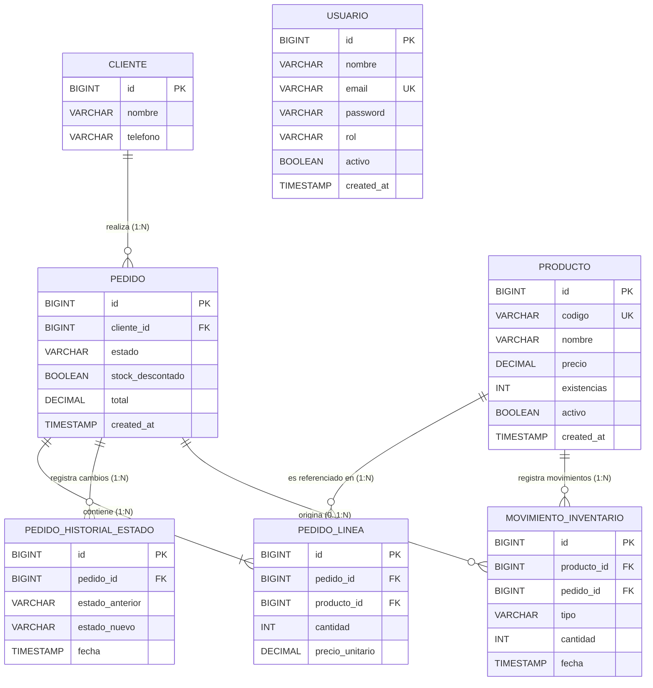

# 05 - Modelo de Datos y Diccionario de la Base de Datos

**Empresa:** La Dorada S.A.S.  
**Sistema:** Gestión de Pedidos e Inventario  
**Base de Datos:** MySQL 8.0 (Motor InnoDB, Charset `utf8mb4`, Collation `utf8mb4_unicode_ci`)  
**Versión:** 1.0.0  
**Fecha:** 2026-11-09  

---

## 1. Diagrama Entidad-Relación (ER)

El esquema de la base de datos `ladorada` consta de 7 tablas normalizadas diseñadas para soportar la operación comercial, el control físico de bodega (Kardex) y la seguridad de acceso por roles.

---

## 2. Diccionario de Datos Detallado

### 2.1 Tabla: `producto`
Almacena el catálogo maestro de artículos distribuidos por La Dorada S.A.S.

| Campo | Tipo SQL | Nulo | Por Defecto | Restricciones | Descripción |
| :--- | :--- | :---: | :---: | :--- | :--- |
| `id` | `BIGINT` | No | Auto-inc | `PRIMARY KEY` | Identificador único del producto en el sistema. |
| `codigo` | `VARCHAR(50)` | No | — | `UNIQUE` (`uq_producto_codigo`) | Código comercial o consecutivo (ej. `ASE-001`, `ASE-002`). |
| `nombre` | `VARCHAR(150)` | No | — | — | Nombre descriptivo del producto y presentación (ej. `Cloro 2 L`). |
| `precio` | `DECIMAL(12,2)` | No | — | `CHECK (precio > 0)` | Precio unitario de venta al público en pesos colombianos ($ COP). |
| `existencias` | `INT` | No | `0` | `CHECK (existencias >= 0)` | Existencias físicas reales disponibles en bodega. |
| `activo` | `BOOLEAN` | No | `TRUE` | — | Bandera de visibilidad comercial para nuevos pedidos. |
| `created_at` | `TIMESTAMP` | Sí | `CURRENT_TIMESTAMP` | — | Fecha y hora de creación del registro. |

**Índices:**
- `idx_producto_codigo` en `(codigo)`: Búsqueda rápida por código de barras o referencia.
- `idx_producto_activo` en `(activo)`: Filtrado eficiente para catálogos comerciales activos.

---

### 2.2 Tabla: `cliente`
Almacena los datos de contacto de los clientes minoristas e institucionales.

| Campo | Tipo SQL | Nulo | Por Defecto | Restricciones | Descripción |
| :--- | :--- | :---: | :---: | :--- | :--- |
| `id` | `BIGINT` | No | Auto-inc | `PRIMARY KEY` | Identificador único del cliente. |
| `nombre` | `VARCHAR(150)` | No | — | — | Razón social o nombre completo del cliente. |
| `telefono` | `VARCHAR(30)` | No | — | — | Número de teléfono o celular para coordinación de despachos. |

**Índices:**
- `idx_cliente_nombre` en `(nombre)`: Optimización de autocompletado y búsqueda por texto.

---

### 2.3 Tabla: `pedido`
Cabecera de las órdenes de pedido registradas por la fuerza comercial.

| Campo | Tipo SQL | Nulo | Por Defecto | Restricciones | Descripción |
| :--- | :--- | :---: | :---: | :--- | :--- |
| `id` | `BIGINT` | No | Auto-inc | `PRIMARY KEY` | Número o consecutivo único del pedido. |
| `cliente_id` | `BIGINT` | No | — | `FOREIGN KEY` -> `cliente(id)` | Cliente al cual se le factura el pedido. |
| `estado` | `ENUM(...)` | No | `'PENDIENTE'` | — | Estado actual: `PENDIENTE`, `CONFIRMADO`, `DESPACHADO`, `RECHAZADO`, `CANCELADO`. |
| `stock_descontado`| `BOOLEAN` | No | `FALSE` | — | Indicador de control de inventario (`TRUE` si ya afectó el stock físico). |
| `total` | `DECIMAL(12,2)` | No | `0.00` | `CHECK (total >= 0)` | Sumatoria consolidada de subtotales de líneas. |
| `created_at` | `TIMESTAMP` | Sí | `CURRENT_TIMESTAMP` | — | Momento exacto de radicación del pedido. |

**Índices:**
- `idx_pedido_cliente_id` en `(cliente_id)`: Consultas de historial por cliente.
- `idx_pedido_estado` en `(estado)`: Filtrado por bandeja de trabajo (pendientes, por despachar, etc.).
- `idx_pedido_created_at` en `(created_at)`: Ordenamiento cronológico de órdenes.

---

### 2.4 Tabla: `pedido_linea`
Detalle de productos y cantidades solicitadas en cada pedido.

| Campo | Tipo SQL | Nulo | Por Defecto | Restricciones | Descripción |
| :--- | :--- | :---: | :---: | :--- | :--- |
| `id` | `BIGINT` | No | Auto-inc | `PRIMARY KEY` | Identificador único de la línea de pedido. |
| `pedido_id` | `BIGINT` | No | — | `FOREIGN KEY` -> `pedido(id)` | Cabecera del pedido a la que pertenece la línea. |
| `producto_id` | `BIGINT` | No | — | `FOREIGN KEY` -> `producto(id)` | Producto solicitado. |
| `cantidad` | `INT` | No | — | `CHECK (cantidad > 0)` | Unidades solicitadas del producto. |
| `precio_unitario` | `DECIMAL(12,2)` | No | — | `CHECK (precio_unitario >= 0)` | Precio unitario congelado al momento del pedido. |

**Índices:**
- `idx_linea_pedido_id` en `(pedido_id)`: Consulta rápida de ítems de una orden.
- `idx_linea_producto_id` en `(producto_id)`: Cruce de ventas por producto.

---

### 2.5 Tabla: `pedido_historial_estado`
Tabla de auditoría para la trazabilidad completa del ciclo de vida del pedido.

| Campo | Tipo SQL | Nulo | Por Defecto | Restricciones | Descripción |
| :--- | :--- | :---: | :---: | :--- | :--- |
| `id` | `BIGINT` | No | Auto-inc | `PRIMARY KEY` | Identificador del evento de auditoría. |
| `pedido_id` | `BIGINT` | No | — | `FOREIGN KEY` -> `pedido(id)` | Pedido que sufrió la transición. |
| `estado_anterior` | `ENUM(...)` | Sí | `NULL` | — | Estado previo a la transición (`NULL` en creación). |
| `estado_nuevo` | `ENUM(...)` | No | — | — | Nuevo estado asignado. |
| `fecha` | `TIMESTAMP` | Sí | `CURRENT_TIMESTAMP` | — | Marca de tiempo precisa del cambio. |

**Índices:**
- `idx_historial_pedido_id` en `(pedido_id)`: Reconstrucción cronológica del historial de una orden.
- `idx_historial_fecha` en `(fecha)`: Auditorías y reportes por rango de fechas.

---

### 2.6 Tabla: `movimiento_inventario`
Kardex transaccional de auditoría de existencias físicas.

| Campo | Tipo SQL | Nulo | Por Defecto | Restricciones | Descripción |
| :--- | :--- | :---: | :---: | :--- | :--- |
| `id` | `BIGINT` | No | Auto-inc | `PRIMARY KEY` | Identificador del movimiento de Kardex. |
| `producto_id` | `BIGINT` | No | — | `FOREIGN KEY` -> `producto(id)` | Producto afectado en inventario. |
| `pedido_id` | `BIGINT` | Sí | `NULL` | `FOREIGN KEY` -> `pedido(id)` | Pedido que originó el descuento o restitución (`NULL` en ajustes). |
| `tipo` | `ENUM(...)` | No | — | — | Tipo de movimiento: `DESCUENTO`, `RESTITUCION`, `AJUSTE`. |
| `cantidad` | `INT` | No | — | `CHECK (cantidad > 0)` | Unidades físicas afectadas. |
| `fecha` | `TIMESTAMP` | Sí | `CURRENT_TIMESTAMP` | — | Fecha y hora exacta del registro del movimiento. |

**Índices:**
- `idx_movimiento_producto_id` en `(producto_id)`: Reconstrucción del Kardex por producto.
- `idx_movimiento_pedido_id` en `(pedido_id)`: Trazabilidad de movimientos asociados a pedidos.
- `idx_movimiento_tipo` en `(tipo)`: Filtrado por naturaleza del movimiento.
- `idx_movimiento_fecha` en `(fecha)`: Informes de cierres de inventario periódicos.

---

### 2.7 Tabla: `usuario`
Tabla de credenciales y roles para el control de acceso al sistema (RBAC).

| Campo | Tipo SQL | Nulo | Por Defecto | Restricciones | Descripción |
| :--- | :--- | :---: | :---: | :--- | :--- |
| `id` | `BIGINT` | No | Auto-inc | `PRIMARY KEY` | Identificador único de usuario. |
| `nombre` | `VARCHAR(100)` | No | — | — | Nombre completo del usuario / colaborador. |
| `email` | `VARCHAR(100)` | No | — | `UNIQUE` (`uq_usuario_email`) | Correo electrónico de inicio de sesión. |
| `password` | `VARCHAR(100)` | No | — | — | Contraseña de autenticación. |
| `rol` | `VARCHAR(30)` | No | — | — | Rol asignado: `ADMINISTRADOR`, `VENDEDOR`, `BODEGA`. |
| `activo` | `BOOLEAN` | No | `TRUE` | — | Indica si el usuario tiene permitido acceder al sistema. |
| `created_at` | `TIMESTAMP` | Sí | `CURRENT_TIMESTAMP` | — | Fecha de registro del usuario. |

---

## 3. Acciones de Integridad Referencial (Llaves Foráneas)

| Llave Foránea | Tabla Origen | Tabla Destino | ON DELETE | ON UPDATE | Justificación Técnica |
| :--- | :--- | :--- | :--- | :--- | :--- |
| `fk_pedido_cliente` | `pedido(cliente_id)` | `cliente(id)` | **RESTRICT** | CASCADE | Impide borrar un cliente si ya tiene pedidos históricos asociados. |
| `fk_linea_pedido` | `pedido_linea(pedido_id)` | `pedido(id)` | **CASCADE** | CASCADE | Si se elimina un pedido borrador, sus líneas se eliminan en cascada. |
| `fk_linea_producto` | `pedido_linea(producto_id)` | `producto(id)` | **RESTRICT** | CASCADE | Protege los productos con pedidos históricos contra borrado accidental. |
| `fk_historial_pedido`| `pedido_historial_estado(pedido_id)` | `pedido(id)` | **CASCADE** | CASCADE | El historial de auditoría acompaña el ciclo de vida del pedido. |
| `fk_movimiento_producto` | `movimiento_inventario(producto_id)` | `producto(id)` | **RESTRICT** | CASCADE | El Kardex de un producto debe conservarse intacto indefinidamente. |
| `fk_movimiento_pedido` | `movimiento_inventario(pedido_id)` | `pedido(id)` | **SET NULL** | CASCADE | Si un pedido es archivado o depurado, el registro de Kardex persiste. |

---

## 4. Restricciones de Dominio (CHECK Constraints)

Para asegurar la regla de **cero inconsistencias de datos** a nivel de motor de almacenamiento, MySQL 8 valida en cada operación `INSERT` y `UPDATE`:
1. `chk_producto_precio`: El precio de venta debe ser estrictamente positivo ($ > 0 $).
2. `chk_producto_existencias`: El stock físico nunca puede ser negativo ($ \ge 0 $).
3. `chk_pedido_total`: El total facturado de la orden nunca puede ser inferior a cero ($ \ge 0 $).
4. `chk_linea_cantidad`: Cada línea de orden debe pedir al menos 1 unidad ($ > 0 $).
5. `chk_linea_precio`: El precio unitario congelado debe ser mayor o igual a cero ($ \ge 0 $).
6. `chk_movimiento_cantidad`: Todo movimiento de inventario debe involucrar cantidades estrictamente positivas ($ > 0 $).
