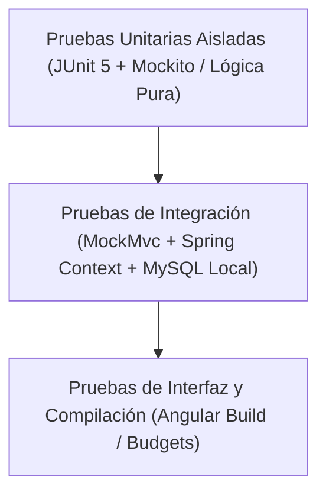

# 07 - Estrategia y Reporte de Pruebas

**Empresa:** La Dorada S.A.S.  
**Sistema:** Gestión de Pedidos e Inventario  
**Versión:** 1.0.0  
**Fecha:** 2026-11-09  

---

## 1. Estrategia de Calidad y Pirámide de Pruebas

La garantía de calidad del sistema de **La Dorada S.A.S.** se fundamenta en una estrategia automatizada en múltiples capas para certificar que ninguna regla de negocio, cálculo de totales ni validación de inventario pueda corromperse ante futuros cambios:



1. **Pruebas Unitarias (Capa Base):** Validan la lógica de negocio pura de los servicios (`InventarioService`, `PedidoService`, `ProductoService`, `ClienteService`, `AuthService`) mediante aislamiento estricto con **Mockito**, simulando repositorios y verificando llamadas atómicas y excepciones esperadas.
2. **Pruebas de Integración (Capa Media):** Ejecutan los controladores REST con **MockMvc** y `@SpringBootTest`, verificando serialización/deserialización JSON, códigos de estado HTTP (200, 201, 400, 401, 404, 409), filtros de seguridad CORS y validación de Bean Validation. Además, certifican la conexión activa con la base de datos MySQL local (`DatabaseConnectionIntegrationTest`).
3. **Validación de Compilación y Bundles Frontend (Capa Superior):** Verificación exhaustiva de tipado estricto en TypeScript, compilación de estilos SCSS y cumplimiento de presupuestos de tamaño (*budgets*) en Angular 17.

---

## 2. Resultados de la Suite Automatizada de Pruebas (Backend)

La ejecución completa de la suite de pruebas mediante el Maven Wrapper (`.\mvnw.cmd test`) certifica un **100% de éxito**:

```
[INFO] Results:
[INFO] 
[INFO] Tests run: 81, Failures: 0, Errors: 0, Skipped: 0
[INFO] 
[INFO] ------------------------------------------------------------------------
[INFO] BUILD SUCCESS
[INFO] ------------------------------------------------------------------------
[INFO] Total time:  26.379 s
```

---

## 3. Matriz Detallada de Pruebas por Módulo

### 3.1 Módulo de Autenticación y Control de Acceso (`auth`)

| Clase de Prueba | Tipo | Pruebas | Casos de Prueba Cubiertos |
| :--- | :---: | :---: | :--- |
| `AuthControllerTest` | Integración (MockMvc) | 4 | - Login exitoso retorna 200 OK con DTO de usuario y rol.<br>- Credenciales inválidas retornan 401 Unauthorized uniforme.<br>- Payload con email/password en blanco retorna 400 Bad Request.<br>- Listado de usuarios activos retorna 200 OK con lista para demo. |
| `AuthServiceTest` | Unitaria (Mockito) | 5 | - Búsqueda de usuario por email y coincidencia de contraseña.<br>- Rechazo cuando el usuario no existe en la base de datos.<br>- Rechazo cuando la contraseña es incorrecta.<br>- Rechazo si la cuenta tiene `activo = false`.<br>- Mapeo exacto de la entidad `Usuario` hacia `UsuarioResponse`. |

---

### 3.2 Módulo de Catálogo y Clientes (`catalogo`)

| Clase de Prueba | Tipo | Pruebas | Casos de Prueba Cubiertos |
| :--- | :---: | :---: | :--- |
| `ProductoControllerTest` | Integración (MockMvc) | 10 | - Listado de productos sin filtros y con filtro `?q=` y `?activo=`.<br>- Consulta por ID existente (200) e inexistente (404).<br>- Creación de producto válida (201 Created).<br>- Rechazo de producto con precio negativo o nombre vacío (400).<br>- Actualización de datos de producto (200 OK).<br>- Modificación de estado activo mediante PATCH (200 OK). |
| `ProductoServiceTest` | Unitaria (Mockito) | 11 | - Generación automática de código consecutivo (`ASE-001`, `ASE-002`, etc.).<br>- Preservación de código si el usuario ingresa uno manual válido.<br>- Actualización de existencias y precios.<br>- Inactivación de producto.<br>- Verificación de restricciones de unicidad. |
| `ClienteControllerTest` | Integración (MockMvc) | 6 | - Listado general de clientes.<br>- Búsqueda por coincidencia de texto en el nombre.<br>- Consulta por ID y manejo de 404.<br>- Creación de cliente válida (201) y rechazo por campos vacíos (400). |
| `ClienteServiceTest` | Unitaria (Mockito) | 6 | - Búsqueda de clientes por término.<br>- Registro de nuevo cliente institucional.<br>- Manejo de clientes no encontrados. |

---

### 3.3 Módulo de Inventario y Kardex (`inventario`)

| Clase de Prueba | Tipo | Pruebas | Casos de Prueba Cubiertos |
| :--- | :---: | :---: | :--- |
| `InventarioControllerTest` | Integración (MockMvc) | 3 | - Consulta de movimientos de Kardex con filtros opcionales (200 OK).<br>- Endpoint de stock bajo retorna productos con existencias $\le 10$ (200 OK).<br>- Ajuste físico de existencias `POST /api/inventario/ajuste` suma stock y retorna producto actualizado (200 OK). |
| `InventarioServiceTest` | Unitaria (Mockito) | 11 | **Integridad ACID y Validación en Dos Fases:**<br>1. **Fase 1 (Validación previa):** Agrupa líneas por `productoId` sumando cantidades y bloquea con `PESSIMISTIC_WRITE`.<br>2. **Ordenamiento Deadlock:** Ordena productos por ID antes de bloquear.<br>3. **Falla parcial no muta nada:** Si el primer producto tiene existencias pero el segundo no alcanza, verifica que `save` **NUNCA** fue invocado para ninguno de los dos y las existencias quedaron intactas.<br>4. **Mensaje consolidado:** Reporta el detalle de todos los productos faltantes en una sola excepción.<br>5. **Fase 2 (Aplicación):** Aplica descuentos y registra movimientos `DESCUENTO` por producto.<br>6. **Líneas repetidas válidas:** Se agrupan correctamente en una sola operación.<br>7. **Restitución:** Restaura existencias en cancelación y registra movimientos `RESTITUCION`.<br>8. **Ajuste de inventario:** Incrementa stock físico y registra movimiento `AJUSTE`. |

---

### 3.4 Módulo de Pedidos (`pedidos`)

| Clase de Prueba | Tipo | Pruebas | Casos de Prueba Cubiertos |
| :--- | :---: | :---: | :--- |
| `PedidoControllerTest` | Integración (MockMvc) | 14 | - Creación de pedido en estado inicial `PENDIENTE` (201 Created).<br>- Rechazo si las líneas están vacías o con cantidades $\le 0$ (400).<br>- Transición `PENDIENTE -> CONFIRMADO` exitosa (200 OK).<br>- Rechazo con 409 Conflict si no hay existencias suficientes.<br>- Transición `CONFIRMADO -> DESPACHADO` por bodega (200 OK).<br>- Transición `CONFIRMADO -> CANCELADO` con restitución automática (200 OK).<br>- Transición `PENDIENTE -> RECHAZADO` (200 OK).<br>- Rechazo de transiciones prohibidas (ej. `DESPACHADO -> PENDIENTE`) con 409 Conflict.<br>- Filtros por estado y cliente. |
| `PedidoServiceTest` | Unitaria (Mockito) | 15 | - Cálculo automático de subtotales y total consolidado del pedido.<br>- Creación en estado inicial `PENDIENTE` con `stock_descontado = false`.<br>- Confirmación invoca `inventarioService.descontar()` y actualiza `stock_descontado = true`.<br>- Cancelación desde `CONFIRMADO` invoca `inventarioService.restituir()` y pasa a `stock_descontado = false`.<br>- Cancelación desde `PENDIENTE` NO invoca restitución.<br>- Despacho exitoso desde `CONFIRMADO`.<br>- Registro obligatorio en `pedido_historial_estado` en cada transición.<br>- Idempotencia ante transiciones repetidas al mismo estado. |

---

### 3.5 Prueba de Integración con Base de Datos

| Clase de Prueba | Tipo | Pruebas | Casos de Prueba Cubiertos |
| :--- | :---: | :---: | :--- |
| `DatabaseConnectionIntegrationTest` | Integración Real (Spring Data + MySQL) | 1 | - Valida la conexión JDBC real hacia `jdbc:mysql://localhost:3306/ladorada`.<br>- Certifica la compatibilidad con el modo `spring.jpa.hibernate.ddl-auto=validate`.<br>- Valida la existencia y correspondencia de las 7 tablas maestras del esquema. |

---

## 4. Pruebas y Certificación del Frontend (Angular 17)

### 4.1 Compilación de Producción y Presupuestos de Tamaño
Se ejecutó la compilación de producción con optimización y *tree-shaking*:
```bash
npm run build
```
**Resultado:**
```
Initial chunk files   | Names                    |  Raw size | Estimated transfer size
chunk-LFSLXMJJ.js     | -                        | 247.95 kB |                67.28 kB
polyfills-FFHMD2TL.js | polyfills                |  33.71 kB |                11.02 kB
main-D37EWXF5.js      | main                     |  10.75 kB |                 2.73 kB
styles-W2RBMCR4.css   | styles                   |   5.53 kB |                 1.29 kB
chunk-KE4E3SUA.js     | -                        |   1.47 kB |               667 bytes

                      | Initial total            | 299.41 kB |                82.97 kB

Application bundle generation complete. [0 errores, 0 advertencias]
```

- **Rendimiento:** Peso inicial transferido comprimido de tan solo **~83 kB**, ideal para dispositivos móviles en terreno.
- **Rutas diferidas (Lazy Loading):** Los módulos funcionales (`pedido-detalle`, `catalogo`, `nuevo-pedido`, `pedidos`, `inicio`, `login`) se compilan en *chunks* independientes y solo se descargan cuando el usuario navega a la ruta respectiva.

### 4.2 Verificación de Control de Acceso en Interfaz
- Los usuarios sin autenticar que intentan ingresar a `/inicio` o `/pedidos` son interceptados por `authGuard` y redirigidos a `/login`.
- Un usuario con rol `BODEGA` que intente ingresar directamente a `/nuevo-pedido` es bloqueado por `roleGuard` y redirigido a `/inicio`.
- Un usuario con rol `VENDEDOR` ve deshabilitadas las opciones de ajuste de stock y despacho logístico.
